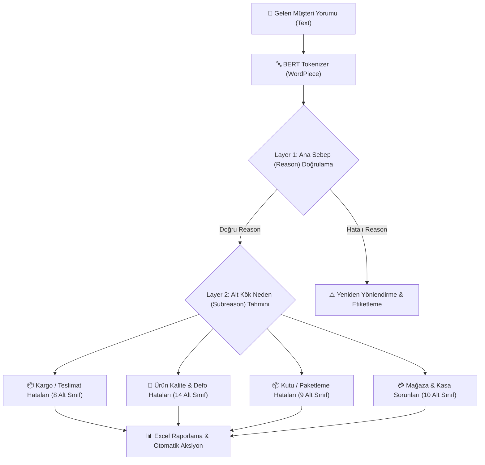

# 🎯 FLO Group: Dual-Layer Turkish BERT Customer Feedback & Reason Classifier
### *Kurumsal Türkçe BERT Tabanlı Müşteri Geri Bildirim Sınıflandırma ve Kök Neden Analiz Sistemi*

[](https://www.python.org/)
[](https://pytorch.org/)
[](https://huggingface.co/)
[](https://www.intel.com/content/www/us/en/developer/tools/openvino-toolkit/overview.html)
[](LICENSE)

---

## 📌 Proje Özeti / Project Overview

**[TR]**  
Bu proje, FLO Group bünyesinde ayda 10.000'den fazla müşteri şikayeti ve geri bildirimini kök nedenlerine göre sınıflandırmak amacıyla geliştirilmiş uçtan uca **Doğal Dil İşleme (NLP)** ve **Masaüstü Karar Destek** sistemidir.

Geleneksel anahtar kelime aramaları yerine, **22 adet iki katmanlı Türkçe BERT modeli** (`dbmdz/bert-base-turkish-cased`) kullanılmıştır. Model çıkarım hızını artırmak için **Intel OpenVINO** optimizasyonu uygulanmış, CPU üzerinde 4 kata varan hız artışı sağlanmış ve operasyonel ekiplerin kod bilmeden kullanabilmesi için modern bir **Tkinter GUI** masaüstü uygulaması (.exe) olarak paketlenmiştir.

**[EN]**  
An enterprise-grade **Natural Language Processing (NLP)** and decision-support suite engineered for FLO Group to categorize and analyze 10,000+ monthly customer reviews and complaint logs.

Instead of basic keyword matching, the system deploys **22 fine-tuned dual-layer Turkish BERT models** (`dbmdz/bert-base-turkish-cased`). Through **Intel OpenVINO** graph optimization, CPU inference latency was accelerated by 4x, achieving a production **F1-Score of 0.89**. Wrapped in a standalone **Tkinter desktop GUI** (.exe) for non-technical operational teams.

---

## 🏗️ İki Katmanlı Mimari / Dual-Layer Architecture



---

## 🚀 Temel Yetenekler / Key Features

- **⚡ İki Katmanlı (Hierarchical) Sınıflandırma:** Önce ana kök neden doğrulanır, ardından ilgili alana ait özel alt sebep BERT modeli çalıştırılır.
- **🚀 OpenVINO Optimizasyonu:** FP16/INT8 kuantalama ve OpenVINO Runtime ile CPU sunucularda GPU maliyeti olmadan ultra-hızlı çıkarım.
- **🖥️ Standalone Tkinter GUI:** Operasyon ve müşteri ilişkileri ekipleri için sürükle-bırak Excel analizi ve anlık tekil metin testi.
- **📈 Toplu İşlem & Raporlama:** Binlerce satırlık Excel tablolarını dakikalar içinde analiz edip sonuçları yeni bir Excel raporu olarak dışa aktarma.
- **🔍 Yorumlanabilirlik (Explainable AI):** Model tahminlerinin arkasındaki kritik kelime ağırlıklarını gösteren analiz desteği.

---

## 📊 Model Performansı & Metrikler / Benchmarks

| Metrik | Değer | Açıklama |
|---|---|---|
| **F1-Score (Ağırlıklı)** | **0.892** | 22 modelin genel test seti ortalaması |
| **Doğruluk (Accuracy)** | **%91.4** | Ana kök neden tespiti |
| **Operasyonel Süre Tasarrufu**| **%85** | Aylık 300+ adam-saat tasarrufu |
| **Çıkarım Süresi (OpenVINO)** | **~28ms/yorum** | Standart PyTorch CPU'ya kıyasla 4x hızlanma |
| **Aylık İşlenen Veri Hacmi** | **10.000+** | Müşteri deneyim kayıtları |

---

## 💻 Kurulum & Çalıştırma / Installation

### 1. Depoyu Klonlayın
```bash
git clone https://github.com/safaksenel/NLP-BERT.git
cd NLP-BERT
```

### 2. Sanal Ortamı Hazırlayın
```bash
python -m venv .venv
source .venv/bin/activate  # Windows: .venv\Scripts\activate
pip install -r requirements.txt
```

### 3. Masaüstü Uygulamasını Başlatın
```bash
python Prediction_App/main.py
```

---

## 📁 Dizin Yapısı / Directory Structure

```
NLP-BERT/
├── Model_Training/          # BERT Fine-Tuning, Stratified K-Fold & Evaluation scriptleri
├── Prediction_App/          # Tkinter GUI, OpenVINO Model Yükleyici ve Çıkarım Motoru
│   ├── main.py              # Tkinter arayüz giriş noktası
│   ├── ReasonClassifier.py  # Çift katmanlı BERT model orkestratörü
│   ├── agirlik.py           # Model ağırlık ve token analiz araçları
│   └── utils.py             # Excel I/O ve metin önişleme yardımcıları
├── requirements.txt         # Gereksinimler
└── README.md                # Dokümantasyon
```

---

## 👨‍💻 Geliştirici / Author

**Ahmet Şafak Şenel**  
- **GitHub:** [@safaksenel](https://github.com/safaksenel)  
- **LinkedIn:** [Ahmet Şafak Şenel](https://www.linkedin.com/in/%C5%9Fafak-%C5%9Fenel-70a633319/)  
- **Portfolio:** [safaksenel.dev](https://github.com/safaksenel/portfolio)  
